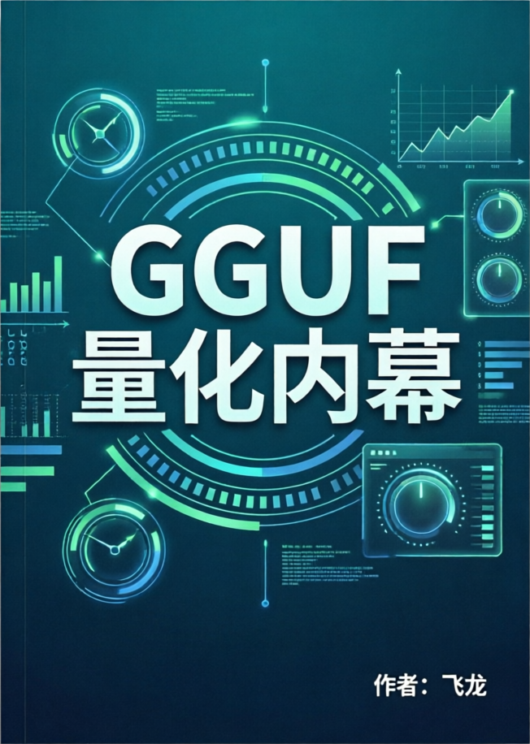

<h1 align="center">GGUF 量化内幕</h1>

> [!WARNING]
> 🧪 Beta公测版本提示：教程主体已完成，正在优化细节，欢迎大家提Issue反馈问题或建议。

*从块量化、K 量化、到码本与三值量化*

本教程涵盖常用热门量化格式 Q2~8K、IQ、UD_IQ，以及最新的三值量化 PTQ1和 STQ1。带有 C++/C#/Python 三种代码解释概念，配有 ASCII Art 图表。

## 项目意义

GGUF 量化技术之所以成为端侧大模型部署和大模型技术普及的关键基础设施，在于它把原本动辄数十GB、依赖高带宽显存和云端算力的模型权重，压缩到手机、笔记本、嵌入式设备可承受的存储与内存带宽范围内。

通过 Q4_0、Q4_K、Q6_K、IQ 码本以及 STQ1/PTQ1 等三值格式的分层设计，GGUF 能在 1.5–6.5 bit/权重之间按张量敏感度灵活取舍，用块内尺度、超级块两级尺度、重要性矩阵和查表码本在显著减小体积的同时尽量保住模型质量，并借助 mmap 加载、逐张量混合精度和 llama.cpp 工具链实现“转换—量化—本地推理”的低门槛闭环。

没有这类量化，端侧部署将受制于内存、功耗和成本而难以落地，大模型也只能停留在云端少数玩家的手中，正是 GGUF 量化让离线、低延迟、隐私可控的本地推理成为现实，从而推动大模型从集中式服务走向更广泛的技术普及。

## 项目受众

想要制作端侧推理引擎，或者制作 GGUF 量化模型的人。

## 在线阅读
https://datawhalechina.github.io/gguf-quant-internals

## 目录

|  章节名   | 简介 | 状态 |
|  ----  | ---- | ---- |
| [第1章 为什么需要 GGUF 量化](docs/chapter01/index.md)  | 端侧部署的"体积—精度—速度"三角，量化术语表与全书路线图 | ✅ |
| [第2章 数值基础与量化误差](docs/chapter02/index.md)  | 浮点与定点表示、量化通式与误差分解、PPL/KL 等评价指标，全书的"分析工具箱" | ✅ |
| [第3章 GGUF 容器与张量类型](docs/chapter03/index.md)  | GGUF 文件的二进制布局，以及用官方 `gguf` 库读写文件的完整 API | ✅ |
| [第4章 Q4_0：块量化的起点](docs/chapter04/index.md)  | 最简块格式，建立"看布局→写公式→选参数→分析误差"的通用分析框架 | ✅ |
| [第5章 Q8_0 与简单块家族](docs/chapter05/index.md)  | Q8_0 近无损基线，Q4_1/Q5_0/Q5_1 的显式最小值偏移 | ✅ |
| [第6章 K-quants 总览：超级块与两级尺度](docs/chapter06/index.md)  | 256 值超级块 × 8 个子块、两级尺度的统一骨架，后续 K 系列的"同一首歌" | ✅ |
| [第7章 Q4_K：最常用的 K-quant](docs/chapter07/index.md)  | 144 字节 `block_q4_K` 布局、6-bit 尺度交错打包、解码与量化端参数估计 | ✅ |
| [第8章 Q5_K：4-bit 主体加高位平面](docs/chapter08/index.md)  | "多出的 1 bit"如何打包进独立 `qh` 数组，高位平面设计 | ✅ |
| [第9章 Q6_K：6-bit 子块与输出层](docs/chapter09/index.md)  | 16×16 子块结构、去掉最小值偏移，以及输出层为何必选 Q6_K | ✅ |
| [第10章 Q2_K 与 Q3_K：极端压缩的边界](docs/chapter10/index.md)  | 2/3-bit 打包的字节布局，"再压一点"在哪里失效 | ✅ |
| [第11章 IQ 系列：重要性矩阵与码本量化](docs/chapter11/index.md)  | 仿射量化在 2 bpw 以下失效，imatrix 加权机制与 IQ1_S 查表格式 | ✅ |
| [第12章 UD_IQ：Unsloth Dynamic 的模型级混合](docs/chapter12/index.md)  | UD 不是新编码，而是用外部搜索决定每个张量用哪种既有格式的策略 | ✅ |
| [第13章 三值量化：STQ1_0 与 PTQ1_0](docs/chapter13/index.md)  | trit 与 base-3 打包、3:4 结构化稀疏、Hadamard 折叠的必需性 | ✅ |
| [第14章 `_S`/`_M`/`_L` 与逐张量混合精度](docs/chapter14/index.md)  | 张量敏感度分层，Q4_K_M 等混合策略的真实构成 | ✅ |
| [第15章 量化工具链与工作流](docs/chapter15/index.md)  | `convert_hf_to_gguf`→`llama-imatrix`→`llama-quantize`→验证的可复现流水线 | ✅ |
| [第16章 llama.cpp 量化代码架构](docs/chapter16/index.md)  | 新增量化格式涉及的三个核心文件与"注册流程"，安全地扩展类型 | ✅ |
| [第17章 反量化与矩阵乘性能](docs/chapter17/index.md)  | roofline 模型与内存带宽瓶颈，tok/s、TTFT 与 P95 的正确测量 | ✅ |
| [第18章 正确性验证与质量评估](docs/chapter18/index.md)  | 从字节级交叉验证到任务级 PPL/KL 的三层验证框架 | ✅ |
| [第19章 跨引擎与格式互操作](docs/chapter19/index.md)  | 自研读取器的实现边界，6-bit 交错/base-3/Hadamard 三类易分叉约定 | ✅ |
| [第20章 未来与标准化](docs/chapter20/index.md)  | 三值与 2-bit 的低比特混合方向，"格式契约"比任何单个格式更值得理解 | ✅ |
| [附录 A 公式速查](docs/appendix-a/index.md)  | 全部量化格式的公式一表：反量化、尺度归一化、块字节数、bpw、type id | ✅ |
| [附录 B 字节布局图集](docs/appendix-b/index.md)  | 16 个核心格式的逐字节 ASCII 布局图、C 结构体与 Python `struct` 描述 | ✅ |
| [附录 C 最小 Python 参考实现](docs/appendix-c/index.md)  | 可独立运行的 GGUF 解析器与 Q4_0/Q4_K/Q6_K/IQ1_S/STQ1_0/PTQ1_0 解码器 | ✅ |
| [附录 D gguf-py API 速查](docs/appendix-d/index.md)  | 顶部导出、元数据字段、常见类型名与读写/落盘/编辑 API | ✅ |
| [附录 E llama.cpp 关键函数索引](docs/appendix-e/index.md)  | 量化、反量化、工具三个函数族的分工与查表索引 | ✅ |
| [附录 F 实验脚本与命令](docs/appendix-f/index.md)  | 从构建、转换、imatrix、量化到 PPL/基准测试的完整命令清单 | ✅ |
| [附录 G 术语表](docs/appendix-g/index.md)  | 全书术语一句话定义，按主题分类便于查阅 | ✅ |
| [附录 H 参考文献与版本说明](docs/appendix-h/index.md)  | 一手来源（llama.cpp、gguf-py）与全书版本核实说明 | ✅ |

## 贡献者名单

| 姓名 | 职责 | 简介 |
| :----| :---- | :---- |
| [张子辰](https://github.com/wizardforcel/) | 项目负责人 | 专注于模型量化、端侧推理和注意力机制改进 |

## 参与贡献

- 如果你发现了一些问题，可以提Issue进行反馈，如果提完没有人回复你可以联系[保姆团队](https://github.com/datawhalechina/DOPMC/blob/main/OP.md)的同学进行反馈跟进~
- 如果你想参与贡献本项目，可以提Pull Request，如果提完没有人回复你可以联系[保姆团队](https://github.com/datawhalechina/DOPMC/blob/main/OP.md)的同学进行反馈跟进~
- 如果你对 Datawhale 很感兴趣并想要发起一个新的项目，请按照[Datawhale开源项目指南](https://github.com/datawhalechina/DOPMC/blob/main/GUIDE.md)进行操作即可~

## 相关项目

+	[从零构建 C++ LLM 推理引擎](https://github.com/datawhalechina/cpp-llm-engine)
+	[从零开始自制大模型推理框架](https://github.com/DracoUnion/Qwen3.5Sharp/tree/master/book)
+	[Qwen3.5Sharp](https://github.com/DracoUnion/Qwen3.5Sharp)
+	[HyMT2Sharp](https://github.com/sdcb/HyMT2Sharp)
+	[zero-to-sglang](https://github.com/datawhalechina/zero-to-sglang)
+	[vllm 源码解析](https://vllm-book.myhubs.dev/)
+	[llama.cpp 源码解析](https://github.com/wizardforcel/llama-cpp-code-analysis)

## 关注我们

扫描下方二维码关注公众号：Datawhale

## LICENSE

 本作品采用<a rel="license" href="http://creativecommons.org/licenses/by-nc-sa/4.0/">知识共享署名-非商业性使用-相同方式共享 4.0 国际许可协议</a>进行许可。
